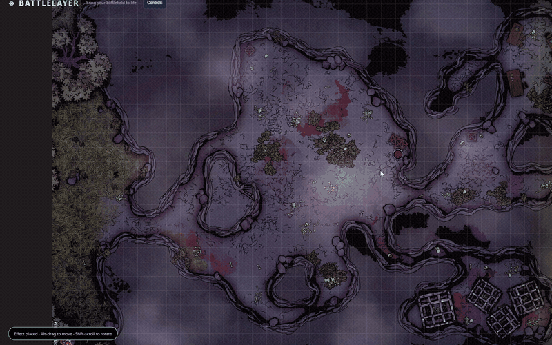
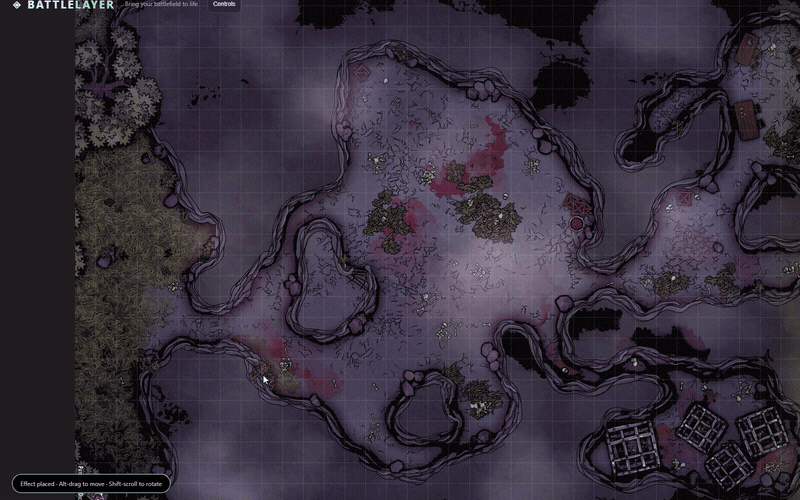
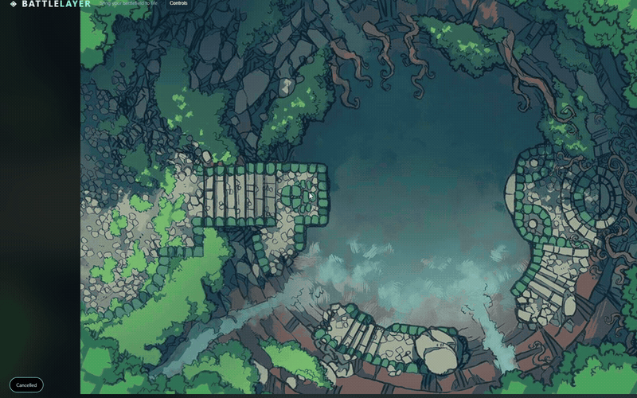
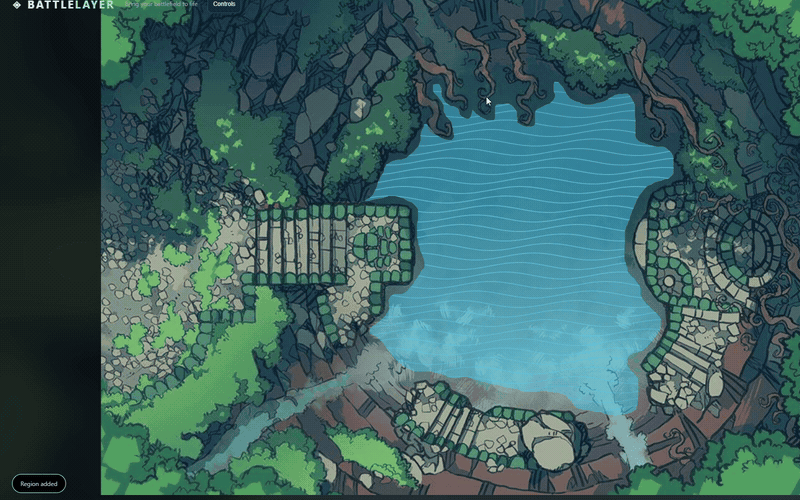
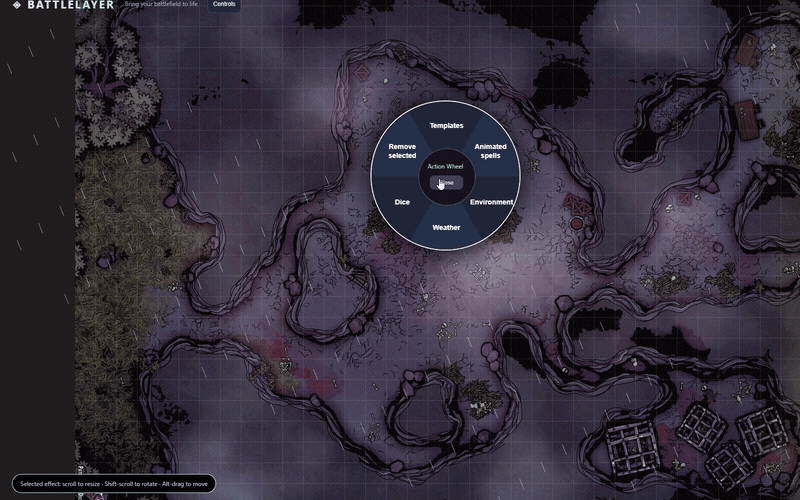
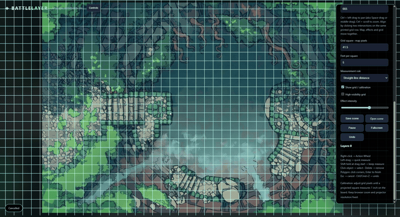

# BattleLayer

**Bring your tabletop to life with animated terrain, spell effects, a visible Action Wheel and quick measurements.**

BattleLayer is built for physical miniatures on a TV or projected whiteboard. Use the Windows app as a transparent overlay above Photos or another desktop app, import a map directly, or project only effects onto a physical battlemat.

## Download and start on Windows

1. Open [Releases](https://github.com/Labstack-Developer/BattleLayer/releases).
2. Choose the newest Windows preview and download the **portable EXE** under **Assets**.
3. Save and run it. No Node.js installation is needed.
4. Open your map in **Photos**, arrange it on the target display, and start BattleLayer.
5. Use **Desktop overlay → Projector / monitor** to choose a screen, then align the grid.

Releases are early previews and executables are unsigned. Each release includes SHA256 checksums. If no release is available yet, a successful [Windows build](https://github.com/Labstack-Developer/BattleLayer/actions/workflows/windows-desktop.yml) also provides a ZIP under its run's Artifacts section.

> **Ctrl + Shift + Space** switches between drawing in BattleLayer and clicking through to the app underneath. In click-through mode the controls hide, while the grid and effects remain visible. Press the shortcut again to return to drawing. **Ctrl + Shift + Escape** quits; the tray menu also offers recovery and quit controls.

## Choose how to display your battlefield

| Display mode | What you see | Best for |
| --- | --- | --- |
| Transparent desktop overlay | Your other app beneath BattleLayer's grid and effects | Windows app over Photos, a browser, or another map viewer |
| Digital battlemap | An imported JPG, PNG or WebP with effects above it | A TV table, or a map managed inside BattleLayer |
| Effects-only projection | Black background with bright grid, menus and effects | Projecting onto a physical whiteboard or printed mat |

Desktop transparency requires the EXE. Opening `index.html` in a browser cannot reveal desktop apps underneath it. In projector mode, black means minimum emitted light; the physical board remains visible, with possible residual projector glow.

## 1. Open the Action Wheel and cast a spell

Right-click the point where you want an effect to start. Choose a circular slice, then an option from its submenu. The centre button goes **Back** or closes the wheel.

- **Animated spells:** Fireball, Lightning and Arcane portal.
- **Templates:** circle, cone, line and square.
- **Environment:** manually drawn Water, Lava and Fog regions.
- **Weather:** Rain, Snow, Wind or Clear.
- **Dice:** D4 through D20.



For a **cone, line or lightning**, move the cursor to aim the live preview and click to confirm. **Escape** cancels. Other spell effects appear at the original right-click point.

Click an effect to select it. **Scroll** changes its size, **Shift + scroll** rotates it, and **Alt + drag** moves it. **Delete** removes the selected object. Fireball currently persists until removed.

## 2. Measure movement and range

**Left-click and drag** to measure between two points. Release to clear the temporary measurement.

Hold **Shift before starting the drag** to keep the measurement on the battlefield. Click a saved measurement and press **Delete** to remove it.



Set **Feet per square** and the measurement rule in Scene studio:

| Rule | Behaviour |
| --- | --- |
| Straight-line distance | Geometric distance between the endpoints |
| 5 ft diagonals | Diagonal and straight grid steps cost the same |
| 5 / 10 ft diagonals | Diagonal steps alternate between one and two squares |

The last two rules round axis distances to squares; endpoints do not snap to the grid. Measurements and templates are visual aids, not automatic rules adjudication.

## 3. Animate a water region

1. Right-click → **Environment → Water region**.
2. Hold the left mouse button and drag to trace the shoreline, or click individual corners.
3. When clicking corners, the dashed preview follows the cursor to show the next edge. You can mix clicking and dragging in one outline.
4. Click the highlighted starting point or press **Enter** to close the shape and apply the animation. **Escape** cancels.



*Drawing demo accelerated 2.5×.*

The animation stays inside your outline. Regions are locked against ordinary battlefield selection so they do not interrupt measurements. Select a region in **Layers** to delete it. The **Effect intensity** slider changes the overall strength of effects.

## 4. Add lava, fog and weather

Use the same drawing controls for **Environment → Lava region** or **Fog region**. Multiple regions can coexist on one battlefield.



*Drawing demo accelerated 1.8×.*

For scene-wide movement, use **Weather → Rain, Snow or Wind**. Choose **Clear** to stop weather. **Pause / Resume** freezes or restarts animation without deleting your scene.

## 5. Roll dice from the wheel

Right-click → **Dice**, then choose the die. The result appears in the status message at the bottom of the battlefield.



Available dice are D4, D6, D8, D10, D12 and D20.

## 6. Line up the grid and arrange the map

### Match a printed grid

1. Turn on **Show grid / calibration**. Tick **High-visibility grid** if the lines are difficult to see.
2. Set **Squares between alignment points**. Using several squares makes accurate alignment easier.
3. Click **Align printed grid**.
4. Click one printed grid intersection, then another on the **same grid row**, separated by the number of squares you entered.
5. Fine-tune **Grid offset X / Y** if needed. You can turn the overlay grid off after calibration; measurements still use its scale.



*Grid-control demo accelerated 2×. The clip shows adjustment; use the steps above to complete your own calibration.*

Alignment currently assumes a square grid aligned with the map axes. It does not correct a skewed photograph or projector perspective.

### Navigate an imported map

- **Upload battlemap:** import PNG, JPEG or WebP, up to 25 MB. The map automatically fits on screen.
- **Fit whole map:** restore a view of the entire imported map.
- **Ctrl + left-drag:** pan the board. Space-drag and middle-drag also work.
- **Ctrl + scroll:** zoom around the cursor; **Map zoom · %** gives numeric control.
- **Rotate board 90°:** turn the map, grid and effects together, then fit the rotated map.

**Desktop overlay is independent of Photos.** Arrange the photo first and leave it fixed after calibrating. Panning, zooming or rotating BattleLayer changes the overlay; it cannot move or track the image inside another app.

### Calibrate for a physical table

Project a grid square onto the board and adjust scale/zoom until it measures the physical size you want (typically **1 inch = 5 feet**). Two-point alignment calibrates a map's printed grid; a physical ruler calibrates the actual projected size. Keep the projector position, resolution and view fixed afterwards. Moving the overlay after calibration moves its alignment too.

## Save your session

**Save scene** downloads a JSON file containing the imported map, effects, measurements, grid settings and view. **Open scene** restores it. An image open in Photos is external and is not embedded in the scene—reopen and position it separately.

Save before quitting: there is currently **no autosave**. **Undo** or **Ctrl + Z** reverses scene edits; redo and measurement endpoint editing are not yet available.

## Shortcut reference

| Input | Action |
| --- | --- |
| Right-click | Open the Action Wheel |
| Left-click | Select an object |
| Left-drag | Temporary measurement |
| Shift held at drag start | Keep the measurement |
| Ctrl + left-drag | Pan the board |
| Ctrl + scroll | Zoom the board |
| Alt + drag on a spell | Move the spell |
| Scroll on a selected spell | Resize |
| Shift + scroll on a selected spell | Rotate |
| Enter / click first point | Finish a region |
| Escape | Cancel drawing or placement / close wheel |
| Delete | Remove selected object |
| Ctrl + Z | Undo |
| Ctrl + Shift + Space | Toggle desktop click-through |
| Ctrl + Shift + Escape | Quit desktop app |

## Other ways to run

### Browser

Open `index.html` in a modern desktop browser, or serve the repository with `python3 -m http.server 8080` and open http://localhost:8080. The browser version works offline after you have the files; desktop transparency is exclusive to the desktop app.

### Desktop from source

Install Node.js LTS, then run in the repository directory:

```sh
npm ci
npm start
```

To build a Windows portable executable on Windows:

```sh
npm run dist:win
```

### Docker

```sh
docker build -t battlelayer .
docker run --rm -p 8080:80 battlelayer
```

Open http://localhost:8080. Docker serves the browser app, not the transparent desktop wrapper.

## Current boundaries

Environmental animations are procedural overlays; they do not distort the original map pixels. There is no automatic region detection, projector perspective correction, synchronized remote display, audio or autosave. Physical terrain can cast shadows. Transparent desktop behaviour depends on Windows and the graphics setup; use the tray controls or recovery shortcut if the overlay is in click-through mode.

## Demo credits

The GIFs are excerpts from Sam's supplied BattleLayer screen recording. Map artwork visible in the recording belongs to its respective creators and is shown as demonstration content, not as bundled reusable battlemaps. See [clip details](docs/media/README.md) for timestamps and editing notes.

## Project and contribution information

See [Contributing](CONTRIBUTING.md), [Security](SECURITY.md), and [usage rights](LICENSE). The code is publicly viewable once the repository is public; an open-source licence has not been granted. Documentation map artwork remains owned by its creators.
